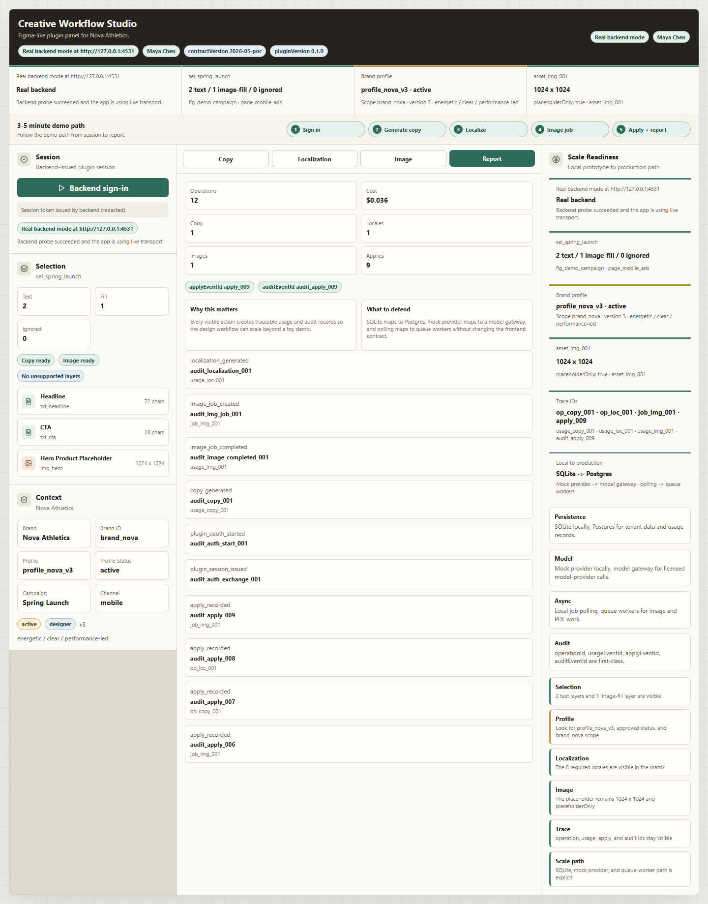

# Creative Workflow Studio

An executable architecture slice for a design workflow: select layers, generate copy, localize eight languages, create an image placeholder, apply an output, and inspect usage and audit records.



The FastAPI backend and SQLite persistence are real. Copy, translations, image pixels, prices, and timing metadata are deterministic demo fixtures. The browser harness exercises the backend; the included Figma development plugin can read and update an actual canvas when imported locally.

## Run locally

Requirements: Python 3.12 and Node.js 24. Create the backend environment and install the locked frontend dependencies:

```sh
python -m venv .venv
# Windows PowerShell
.venv/Scripts/python -m pip install -r project/poc/backend/requirements.txt
# macOS/Linux: use .venv/bin/python for the same pip command
cd project/poc/frontend
npm ci
cd ../../..
python scripts/dev.py
```

Open <http://127.0.0.1:4532>. The launcher binds the API to loopback port 4531 and stops its own children on Ctrl+C. SQLite data stays in the ignored backend `.data` directory. It refuses occupied ports rather than interrupting another service.

1. Choose **Backend sign-in**, then wait for the approved brand profile and the selection of two text layers plus one image-fill layer.
2. **Generate copy**. Select a variant to record an apply event.
3. Open **Localization**, choose **Localize**, and inspect all eight locales. Apply one result.
4. Open **Image**, create the 1024 × 1024 placeholder, wait for completion, and apply it.
5. Open **Report** to inspect persisted operations, costs, apply events, and audit identifiers.

With no API URL configured the browser falls back to labelled local fixtures. The root launcher configures a real backend URL. An unreachable configured backend is shown explicitly, and requests have a 12-second bound.

## Architecture and scope

- FastAPI owns tenant/brand context, policy, profile versions, operations, image-job lifecycle, persistence, and audit identifiers.
- React is the browser interaction harness. Its apply buttons record events; actual Figma canvas mutation belongs to the development plugin.
- [The Figma plugin](project/figma-plugin/README.md) uses an explicit development-only loopback allowlist. It is not published to Figma Community.
- [Architecture notes](docs/architecture.md) explain the production path and the boundaries that are already executable.

The sign-in exchange and signing secret are fixed public demo fixtures. They do not authenticate real users. OIDC, a model gateway, tenant-isolated PostgreSQL, queue workers, object storage, authorization hardening, and operational limits are future production work. Keep this prototype on your own machine.

## Verify

```sh
# Windows; use .venv/bin/python on macOS/Linux
.venv/Scripts/python -m pytest
cd project/poc/frontend
npm run build
npm run smoke
```

CI checks the backend, TypeScript build, and frontend contract smoke. Current browser verification covers the complete workflow against SQLite. Native Figma import and canvas apply are provided in the source but were not repeated during this refresh; the historical Figma screenshot is retained separately.

## Project context and AI use

This is a refreshed edition of Kallas Lima's existing creative-workflow prototype. The overlapping private assessment implementation is represented here once. AI was used extensively for research, implementation support, review, iteration, and documentation; the architecture, direction, tradeoffs, and final decisions are Kallas's. The original MIT license is retained.
