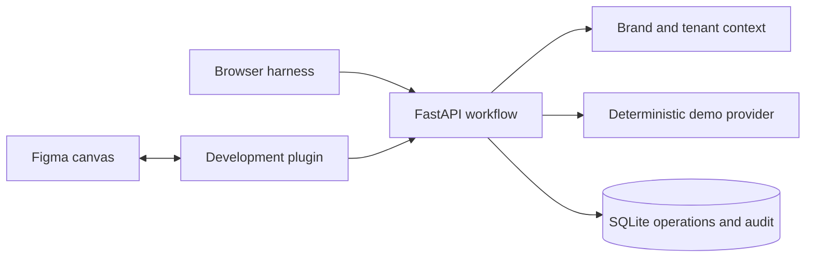

# Workflow boundaries

The browser harness and Figma iframe send requests to a backend-owned workflow. A selected-layer payload describes two text nodes and one image-fill node; an approved brand profile supplies voice and channel constraints. Operations return identifiers that connect usage, apply, and audit records.

Copy generation returns bounded variants for each text layer. Localization returns eight explicit locales. Image creation returns a queued job; polling advances it through running and completed states to a deterministic placeholder. Apply events carry the source operation and target layer so usage can be distinguished from a designer's actual application of an output.

The browser records an apply event without access to a canvas. The plugin performs the canvas change through its main-thread bridge before reporting it. Production design must handle a successful canvas change followed by an unavailable apply-event endpoint, including idempotency and recoverable reporting.

The current exchange is a local fixture, not production OAuth. A real rollout needs OIDC/PKCE, tenant-scoped authorization at every operation and data boundary, model-provider policy, object storage, explicit retention rules, and durable queued jobs. Moving SQLite to PostgreSQL and polling work to workers preserves the operation contract but requires migrations, retry semantics, concurrency control, and observability.

No production benchmark is claimed. The fixture latency and cost values exist to exercise the interface and reporting contract.
